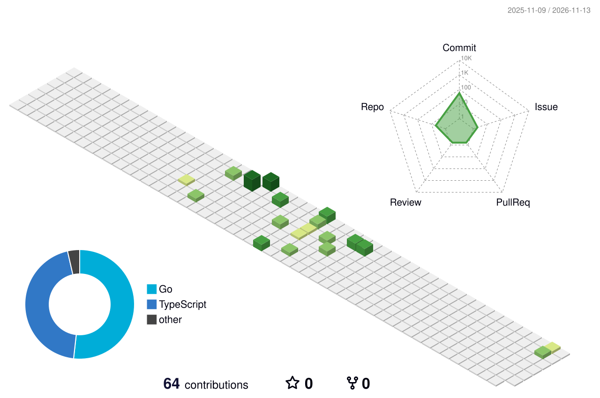

<!--
  README do perfil do GitHub.
  Comentários como este não aparecem na página: servem só para explicar o arquivo.
  As imagens em profile/ e profile-3d-contrib/ são geradas pelo workflow .github/workflows/profile.yml.
-->

<!-- ========== 1. TÍTULO ========== -->
# Hi, I'm Lucas Hipólito 👋

**Software Engineering student at UFG (Universidade Federal de Goiás)**

🇧🇷 [Leia em português](#pt-br)

<!-- ========== 2. SOBRE MIM (inglês) ========== -->
## About me

I'm interested in programming, data analysis and how to build **scalable applications**.
I've built an application in **Go**, I'm currently studying **C++** and I plan to learn **Java** next.
I'm always looking for opportunities to learn and grow in software development.

<!-- ========== 3. BOTÕES DE CONTATO ==========
  Cada botão é uma imagem do shields.io dentro de um link.
  Formato da URL: https://img.shields.io/badge/<TEXTO>-<COR>?style=for-the-badge
-->
## Contact

  
  
  

<!-- ========== 4. TECNOLOGIAS ==========
  "logo=" usa os ícones do simpleicons.org. "C%2B%2B" é "C++" codificado para URL.
-->
## Tech stack

**Using / Uso**

  
  
  
  
  

**Learning next / Próximos passos**

  

<!-- ========== 5. ESTATÍSTICAS ==========
  <picture> mostra uma imagem diferente para o tema escuro e para o claro do GitHub.
-->
## GitHub stats

  <picture>
    <source media="(prefers-color-scheme: dark)" srcset="./profile/stats-dark.svg">
    
  </picture>
  <picture>
    <source media="(prefers-color-scheme: dark)" srcset="./profile/top-langs-dark.svg">
    
  </picture>

<!-- ========== 6. GRÁFICO 3D DE CONTRIBUIÇÕES ========== -->
## Contributions

<picture>
  <source media="(prefers-color-scheme: dark)" srcset="./profile-3d-contrib/profile-night-rainbow.svg">
  
</picture>

<!-- ========== 7. PROJETOS (inglês) ========== -->
## Projects

| Project | What it shows | Technologies |
|---|---|---|
| Go application 🔒 *(private for now)* | Building a complete application in Go | Go |
| C++ exercises *(coming soon)* | Practice with C++ fundamentals, algorithms and data structures | C++ |

---

<!-- ========== VERSÃO EM PORTUGUÊS ==========
  Só os textos são repetidos; botões, selos e gráficos acima valem para as duas línguas.
-->

## 🇧🇷 Versão em português

**Estudante de Engenharia de Software na UFG (Universidade Federal de Goiás)**

### Sobre mim

Tenho interesse em programação, análise de dados e em como construir **aplicações escaláveis**.
Já desenvolvi uma aplicação em **Go**, atualmente estudo **C++** e pretendo aprender **Java** em seguida.
Estou sempre buscando oportunidades para aprender e crescer no desenvolvimento de software.

### Projetos

| Projeto | O que demonstra | Tecnologias |
|---|---|---|
| Aplicação em Go 🔒 *(privada por enquanto)* | Desenvolvimento de uma aplicação completa em Go | Go |
| Exercícios de C++ *(em breve)* | Prática de fundamentos, algoritmos e estruturas de dados em C++ | C++ |
